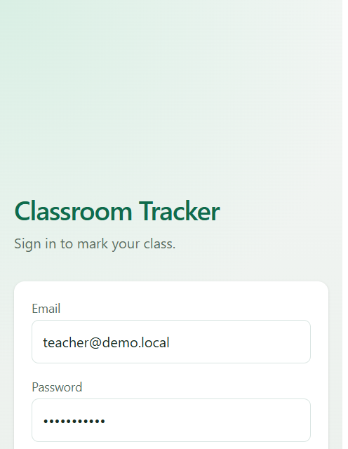
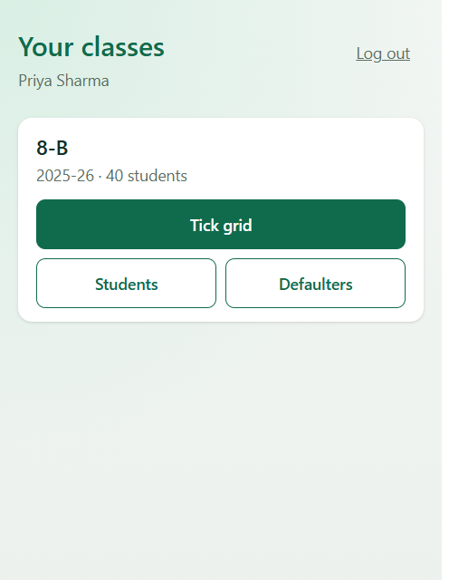
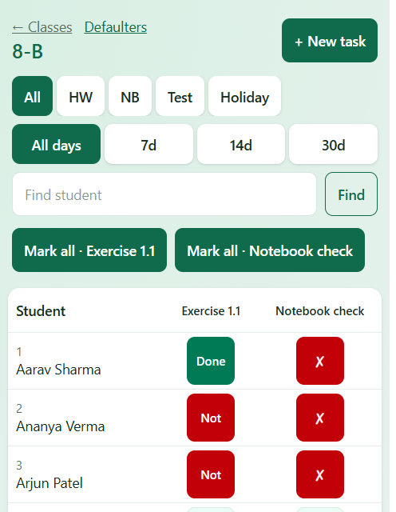
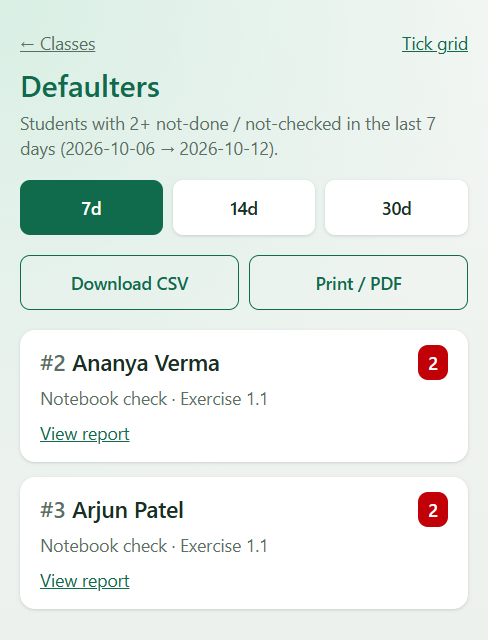

# Classroom Tracker

Mobile-first web app for school teachers to track day-to-day classroom work
that tools like Google Classroom don't handle well in **physical** classrooms:
who did the homework, which notebooks were checked, weekly-test marks, and
holiday homework parts.

Built as a portfolio project by a BSc CS student and former teacher. The primary
user is a teacher marking a class of ~40 students on a phone, standing in a
classroom — marking the whole class should take under a minute.

## Status

**V3 complete** — usable V1/V2 product plus PWA offline marks, class-teacher
RBAC, Playwright smoke E2E, and a shared-package coverage floor.

**Deploy (almost live):** Neon is migrated + seeded. Latest `main` is pushed
with a demo-friendly Blueprint (`SMS_OTP_MODE=log`). Finish Render + Vercel
once (checklist: [docs/DEPLOY.md](docs/DEPLOY.md)), then reply with both URLs.

Live demo: _pending your Render + Vercel login_

- Web: `https://<your-app>.vercel.app`
- API health: `https://classroom-tracker-api.onrender.com/health` _(expected Blueprint name)_

Demo teacher (after `npm run db:seed`; seed refuses `NODE_ENV=production`):

- Email: `teacher@demo.local`
- Password: `Teacher123!`

## Screenshots

Phone-width captures from the seeded demo class **8-B** (40 students).

| Login | Classes |
| --- | --- |
|  |  |

| Tick grid | Defaulters |
| --- | --- |
|  |  |

## What it does

- **Sign in / Sign up** — email + password + Indian mobile; SMS OTP (Twilio) before the account is created; school access still needs an admin invite
- **Home dashboard** — per class: today's tasks with pending counts, rolling defaulters, quick links to grid / students / defaulters
- **Classes** — **New class** for schools you belong to (demo seed has one school)
- **CSV roster import** — class teachers import students from a file or paste (per-row errors)
- **Tick grid** — students × tasks; tap to cycle status; bulk “mark all done”
- **Task types** — daily homework, notebook check, weekly test (marks), holiday homework (parts), **attendance** (present / absent / late on the same grid)
- **Take attendance** — one tap creates today's attendance column; tap cycles P ↔ A
- **Defaulters** — students with 2+ `NOT_DONE` / `NOT_CHECKED` in the last N Kolkata days; **WhatsApp** parents (per student + copy-all) when `parentContact` is set
- **Student report** — per-student summary; parent share link (hashed URL); CSV / print PDF
- **Offline marks** — PWA caches the last grid; status taps queue and sync on reconnect
- **RBAC** — class teachers manage roster + parent links; subject teachers mark the grid

## Measurable numbers

| Metric | Value |
| --- | --- |
| Seeded demo class | 1 school, 1 teacher, **40** students, 2 sample tasks |
| Unit / integration tests | **167** across api + web + shared (`npm test`) |
| Shared package coverage | **~98%** lines (CI floor: 90% lines/functions/statements, 85% branches) |
| Playwright smoke | 1 browser flow: login → tick grid → mark a cell |
| Prisma models | 12 (unified `Task` / `TaskStatus` for all activity types) |
| Target class size | ~40 students; full-class marking under a minute on a phone |

## Architecture

```
apps/web  (React + Vite + PWA)  →  Vercel
    |  VITE_API_BASE_URL + credentials
    v
apps/api  (Fastify + Prisma + JWT)  →  Render
    |
    v
PostgreSQL  →  Neon  (Docker Compose for local)
packages/shared  (Zod schemas + status rules shared by web + api)
```

CI (GitHub Actions): lint, format, typecheck, build, unit tests, shared
coverage, Playwright smoke against Postgres.

## Design decisions

| Decision | Why | Trade-off |
| --- | --- | --- |
| npm workspaces monorepo | Share Zod types between web and API; one CI pipeline | Slightly heavier than two separate repos |
| Unified task model | One `Task` + `TaskStatus` for all activity types | Type rules live in application code |
| Short-lived access JWT + hashed refresh sessions | Cookie lifetime follows `JWT_REFRESH_TTL`; refresh rotates; logout revokes | A stolen refresh token works only until the next refresh or logout |
| Single-flight refresh on 401 | One expired access token does not log the teacher out mid-class | If refresh fails, the session clears and the browser goes to login |
| CORS allowlist, helmet, and login rate limit | Cookies are origin-scoped; login/register capped per IP | Local `.env` must list the web origin in `CORS_ORIGINS` |
| School membership, not open bootstrap | Admin creates the school and invites teachers | A teacher cannot self-join a school |
| Partial CSV import with per-row errors | Fix bad rows without redoing the whole file | Class may be half-imported until they re-run |
| Task + statuses in one transaction | No task without a full PENDING grid | Large classes = bigger write; fine for ~40 |
| Optimistic status cycle + version check | Feels instant on a phone; 409 if another update won | Needs refresh after conflicts |
| SQL aggregation for defaulters | One query with `HAVING COUNT(*) >= 2` | Miss criteria are status-based, not “late vs due date” |
| Parent link = hashed secret URL | WhatsApp-friendly read-only report without parent accounts | Anyone with the URL can view until revoke/expiry |
| CSV on the API; PDF via browser print | Excel-friendly files without a PDF dependency | Print layout depends on the browser |
| Filter the grid; paginate lists | Phone UI stays fast as history grows | List responses use `{ items, page, pageSize, total, totalPages }` |
| PWA shell + local outbox for marks | Keep ticking during a classroom dead zone | Only status PUTs are queued |
| Class teacher vs subject teacher RBAC | Roster and parent links stay with the class teacher | Register creates `TEACHER`; admin invite can set `CLASS_TEACHER` |
| Coverage floor on `@classroom-tracker/shared` | Zod + status rules are the product contract | API/web stay integration-tested without a global % gate |
| Split deploy (Vercel + Render + Neon) | Free tiers for a portfolio demo | Cross-origin cookies need SameSite=None; Render cold-starts |

## Prerequisites

- Node.js 20+
- Postgres via Neon (linked) or Docker Desktop for local Compose

## Local setup

```bash
npm install
cp .env.example .env
cp .env apps/api/.env
npm run db:migrate
npm run db:seed
npm run dev:api
npm run dev:web
```

- Web: http://localhost:5173
- API health: http://localhost:3001/health

Open the web app → sign in → pick **8-B** → tick grid, students (report +
parent link), or defaulters.

**PWA:** production builds register a service worker. Install from the browser
(“Add to Home Screen”). The tick grid caches the last successful load and
queues marks while offline, then syncs on reconnect.

## Scripts

| Command | What it does |
| --- | --- |
| `npm run lint` / `typecheck` / `test` | Quality checks |
| `npm run test:coverage` | Shared Zod/rules coverage (90% / 85% floors) |
| `npm run test:e2e` | Playwright smoke (starts API + web; needs DB + JWT secrets) |
| `npm run db:migrate` | Apply migrations |
| `npm run db:seed` | Seed demo school / teacher / class / 40 students |

First-time E2E browsers (once per machine):

```bash
npx playwright install chromium
```

## API surface

### Auth

| Method | Path | Notes |
| --- | --- | --- |
| POST | `/auth/register` | Starts sign-up (`name`, `email`, `password`, `phone`) → SMS OTP; returns `{ status: "otp_sent", registrationId, phone }` |
| POST | `/auth/verify-phone` | Body `{ registrationId, code }` — creates `TEACHER` + session |
| POST | `/auth/resend-otp` | Resends SMS for a pending registration |
| POST | `/auth/login` | Returns `{ accessToken, user }`, sets refresh cookie |
| POST | `/auth/refresh` | Rotates tokens using httpOnly `refreshToken` cookie |
| POST | `/auth/logout` | Revokes the refresh token and clears the cookie |
| GET | `/auth/me` | Requires `Authorization: Bearer <accessToken>` |
| GET | `/home` | Teacher home: today's tasks + defaulter counts per class |

### Classes & students

| Method | Path | Notes |
| --- | --- | --- |
| GET | `/schools` | Schools the caller belongs to (ADMIN: all) |
| POST | `/schools` | ADMIN creates a school |
| POST | `/schools/:schoolId/members` | ADMIN invites by email; optional `role`: `TEACHER` \| `CLASS_TEACHER` |
| GET | `/classes` | Classes assigned to the teacher |
| POST | `/classes` | Create a class in a school the teacher belongs to |
| GET | `/classes/:classId/students` | Paginated students (`page`, `pageSize` default 40, optional `q`) |
| POST | `/classes/:classId/students/import` | CSV import — **CLASS_TEACHER** or **ADMIN** only |

CSV columns: `rollNumber`, `name`, optional `parentContact`. Max 200 rows per
import. A roll that belongs to a student in a class you cannot access is a
per-row error (no rename / enroll).

### Tasks & tick grid

| Method | Path | Notes |
| --- | --- | --- |
| POST | `/classes/:classId/tasks` | Create task + PENDING statuses (transaction) |
| GET | `/classes/:classId/tasks` | Paginated tasks (`page`, `pageSize`, optional `type`) |
| GET | `/tasks/:taskId` | Task detail with `statusCount` |
| GET | `/classes/:classId/grid` | Students × tasks × statuses; filters `type`, `days`, `q` |
| PUT | `/task-statuses/:statusId` | Body `{ status, version }` (+ optional marks/parts) |
| POST | `/tasks/:taskId/mark-all-complete` | Only updates **PENDING** → DONE/CHECKED |

Create types: `DAILY_HOMEWORK`, `NOTEBOOK_CHECK`, `WEEKLY_TEST` (requires
`maxMarks`), `HOLIDAY_HOMEWORK` (requires `totalParts`), `ATTENDANCE`
(present=`DONE` / absent=`ABSENT` / late=`INCOMPLETE`).  
`assignedOn` / `dueOn` are **Asia/Kolkata** calendar dates (`YYYY-MM-DD`).

### Defaulters, reports, parents, export

| Method | Path | Notes |
| --- | --- | --- |
| GET | `/classes/:classId/defaulters?days=7` | 2+ misses in last N Kolkata days (`days` 1–90) |
| GET | `/classes/:classId/students/:studentId/report?days=30` | Per-student summary + rows |
| GET/POST/DELETE | `/classes/:classId/students/:studentId/parent-link` | Class teacher / admin |
| GET | `/parent/:token/report?days=30` | Public read-only report |
| GET | `/parent/:token/report.csv?days=30` | Public CSV |
| GET | `/classes/:classId/students/:studentId/report.csv?days=30` | Teacher CSV |
| GET | `/classes/:classId/defaulters.csv?days=7` | Teacher CSV |

PDF: **Print / PDF** in the web UI (browser print → Save as PDF).

## Out of scope

Fees, timetable, transport, library, payroll, chat, staff attendance, AI —
this is a classroom tracker, not a school ERP.
